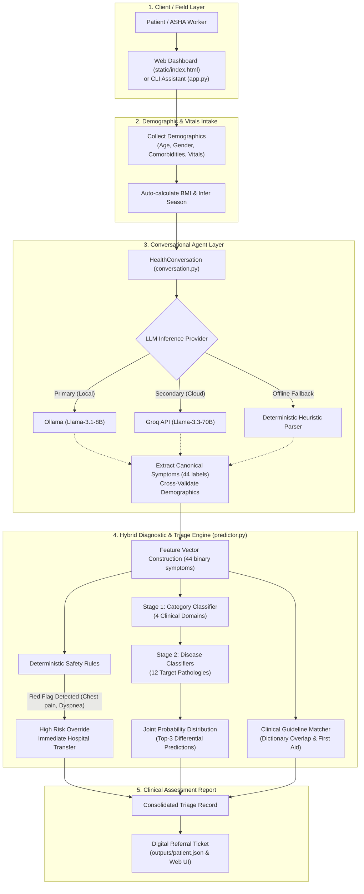

# CareTriage AI: Offline-First Hybrid Clinical Triage & Conversational Intake System

[](https://www.python.org/)
[](https://flask.palletsprojects.com/)
[](https://catboost.ai/)
[](https://ollama.com/)
[](#architecture)

> **Research Prototype Notice:** CareTriage AI is an engineering research prototype developed for frontline healthcare triage simulation (e.g., Accredited Social Health Activists [ASHA] and Auxiliary Nurse Midwives [ANM] in rural India). It is **not** a clinically validated Medical Device and must **not** be used as a standalone diagnostic tool.

---

## 1. Problem Statement & Motivation

In low-resource and rural healthcare settings (such as Primary Health Centres [PHCs] across grassroots India), patients face severe last-mile hurdles:

1. **Absence of Early Risk Triage:** Patients frequently cannot assess whether symptoms warrant immediate emergency transfer, a clinic visit within 48 hours, or supportive home care. This leads either to fatal delays for acute emergencies or severe overcrowding at regional referral hospitals.
2. **Connectivity & Literacy Barriers:** Existing telehealth solutions depend heavily on high-speed internet, complex typed questionnaires, and modern smartphones, alienating rural populations and village health workers.
3. **The AI Reliability Dilemma:** Relying solely on large language models (LLMs) for clinical triage introduces hallucination and non-deterministic variability. Conversely, pure tabular statistical models cannot converse naturally with patients or extract clinical complaints from freeform colloquial dialogue.

---

## 2. Solution Overview

**CareTriage AI** bridges this gap through a **hybrid applied AI architecture**:

* **Conversational Symptom Intake Agent:** A multi-turn dialogue assistant that converses naturally with patients, validates physiological consistency against pre-collected demographics, and standardizes freeform descriptions into a **canonical 44-symptom clinical vocabulary**. Operates with a **3-tier fault-tolerant fallback** (Local Ollama &rarr; Groq Cloud API &rarr; Deterministic Offline Heuristic Parser).
* **Hierarchical Dual-Stage Machine Learning Engine:** Rather than predicting across all conditions simultaneously, a stacked Random Forest architecture first predicts the high-level **clinical domain** (Stage 1), and then routes to a specialized **disease classifier** (Stage 2) across 12 target pathologies, delivering a **+46.00% Top-1 accuracy boost** over baseline flat models.
* **Deterministic Safety & Risk Escalation Rules:** Statistical predictions are strictly subordinated to clinical red-flag rules. Life-threatening symptoms (e.g., shortness of breath, acute chest pain, severe dehydration) trigger an **immediate High Risk override** with urgent transfer guidance, bypassing model confidence scores.
* **ASHA Worker Companion & Kiosk Interface:** A lightweight, glassmorphic web dashboard with one-tap quick answer chips, touch-friendly sliders, and instant digital triage report generation.

---

## 3. Architecture & Data Flow



---

## 4. Key Features

* **3-Tier Fault-Tolerant Conversational Agent:**
  * **Tier 1 (Local Edge):** Runs offline via local Ollama (`llama3.1:8b`).
  * **Tier 2 (Cloud Fallback):** Uses Groq API (`llama-3.3-70b-versatile`) when configured and online.
  * **Tier 3 (Zero-Dependency Offline Heuristic):** Employs rule-based regex and keyword parsing if neither LLM runtime is available. The application **never crashes** due to network outages or missing API keys.
* **Medical Context Cross-Validation:** System prompt instructs the agent to detect physiological contradictions between patient claims and intake context (e.g., recorded male patient mentioning pregnancy) and clarify before proceeding.
* **Strict Interview Guardrails:** System prompt strictly prohibits the conversational agent from diagnosing, prescribing medications, or reassuring patients, restricting its scope strictly to symptom extraction within 3–5 dialogue turns.
* **Canonical Symptom Standardization:** Maps colloquial descriptions (e.g., *"belly pain"*, *"tummy ache"*) into 44 standardized clinical symptom flags.
* **Stacked Hierarchical Differential Diagnosis:**
  * **Stage 1 (Domain Predictor):** Classifies symptoms into 4 clinical categories (*Acute Infectious*, *Cardiorenal & Metabolic*, *Respiratory & Digestive*, *Systemic & Psychiatric*).
  * **Stage 2 (Pathology Predictor):** Selects the target disease within the predicted domain across 12 conditions.
* **Deterministic Risk Escalation:**
  * **High Risk:** Automatically triggered by red-flag symptoms (*shortness of breath, chest pain, dehydration, blurred vision, numbness*) or moderate symptoms in comorbid patients. Recommends immediate hospital transfer accompanied by an ASHA worker.
  * **Moderate Risk:** Advises Primary Health Centre (PHC) review within 24–48 hours.
  * **Low Risk:** Provides home supportive care instructions and hydration guidelines.
* **Interactive Test Runner & Dual-Mode Testing:** Includes a menu-driven CLI test runner (`cli_test_menu.py`) and automated API verification (`test_server.py`) that executes in-process via Flask's test client when no live server is bound.

---

## 5. Technology Stack

| Domain | Technology | Purpose |
| :--- | :--- | :--- |
| **Backend & API** | Python 3.10+, Flask 3.1, Flask-CORS | REST API serving session management and static assets |
| **Machine Learning** | Scikit-learn, CatBoost, NumPy, Pandas | Hierarchical Random Forest stacking and baseline CatBoost model |
| **Conversational Agent** | Ollama, Groq Python SDK, python-dotenv | Local Llama-3.1 inference, cloud fallback, and prompt orchestration |
| **Frontend UI** | HTML5, Modern CSS3 (Glassmorphism), Vanilla JavaScript | Responsive desktop/tablet/mobile triage dashboard |
| **Testing & Evaluation** | Requests, Flask Test Client, Pandas | Automated API validation, clinical vignettes suite, and CLI test menu |

---

## 6. Repository Structure

```text
├── app.py                      # Standalone CLI conversational triage workflow
├── server.py                   # Flask REST API backend & static file server
├── conversation.py             # 3-tier conversational LLM orchestration (Ollama/Groq/Heuristic)
├── predictor.py                # Hierarchical ML predictor, CatBoost baseline & risk triage logic
├── prompts.py                  # Clinical interview system prompt & 44 canonical symptom definitions
├── utils.py                    # Robust JSON extraction from LLM responses
├── train_hierarchical.py       # Script to train Stage 1 and Stage 2 Random Forest classifiers
├── cli_test_menu.py            # Menu-driven interactive test runner & benchmark evaluator
├── test_server.py              # Automated API test suite (dual-mode: HTTP or in-process test client)
├── test_vignettes.py           # 50-sample clinical vignettes accuracy benchmark comparison
├── requirements.txt            # Python dependencies
├── .env.example                # Template for environment configuration
├── .gitignore                  # Git hygiene rules (excludes caches, bytecode & runtime dumps)
├── models/
│   ├── all_symptoms.pkl        # Serialized list of the 44 canonical symptoms
│   ├── feature_columns.pkl     # Feature schema required by CatBoost baseline
│   ├── disease_prediction_model.cbm # Baseline CatBoost classifier model
│   └── hierarchical/
│       ├── stage1_model.pkl    # Stage 1 Category Random Forest model (4 clinical domains)
│       └── stage2_models.pkl   # Stage 2 Disease Random Forest models (per-domain classifiers)
├── static/
│   ├── index.html              # Single-page glassmorphic web dashboard
│   ├── script.js               # Frontend API integration & dynamic DOM rendering
│   └── style.css               # Responsive styling & status badges
└── examples/
    └── sample_patient_triage_output.json # Sample completed triage record
```

---

## 7. Installation & Setup

### Prerequisites

* Python 3.10, 3.11, 3.12, or 3.13
* Git

### Step 1: Clone the Repository

```bash
git clone https://github.com/sourasish-mukherjee1904/innovation_challenge.git
cd innovation_challenge
```

### Step 2: Create a Virtual Environment

```bash
python3 -m venv .venv
source .venv/bin/activate    # On Windows: .venv\Scripts\activate
```

### Step 3: Install Dependencies

To install all pinned packages:

```bash
pip install -r requirements.txt
```

Alternatively, to install only core runtime dependencies:

```bash
pip install flask flask-cors pandas scikit-learn catboost requests python-dotenv groq kagglehub
```

### Step 4: Configure Environment Variables (Optional)

Copy `.env.example` to `.env`:

```bash
cp .env.example .env
```

| Variable | Default | Purpose |
| :--- | :--- | :--- |
| `PORT` | `5000` | Port for the Flask backend server |
| `GROQ_API_KEY` | *(empty)* | Optional API key for Groq Cloud fallback (`llama-3.3-70b-versatile`) |
| `KAGGLE_DATASET_CSV`| *(auto)* | Path to Kaggle dataset CSV (only needed to retrain models or run 200-sample evaluations) |

*Note: If neither Ollama nor `GROQ_API_KEY` is provided, the system automatically uses its built-in offline heuristic assistant.*

---

## 8. How to Run the Application

### Option A: Web Dashboard (Recommended)

1. Start the Flask server:

   ```bash
   python server.py
   ```

2. Open your browser and navigate to:

   ```text
   http://127.0.0.1:5000
   ```

*(On macOS, if port 5000 is occupied by AirPlay Receiver, run `PORT=5050 python server.py` and open `http://127.0.0.1:5050`)*.

### Option B: Interactive CLI Assistant

Run the terminal intake assistant directly:

```bash
python app.py
```

Follow the demographic prompts, chat with the assistant, and type `done` to generate the triage record.

---

## 9. How to Run Tests

### Automated API & Triage Integration Test

```bash
python test_server.py
```

*This script verifies the full triage cycle (`/api/start-session` &rarr; `/api/chat` &rarr; `/api/finalize`). It automatically connects to a live server if running, or runs in-process via Flask's test client.*

### Interactive Menu-Driven Test Runner

```bash
python cli_test_menu.py
```

Presents a menu to:
1. Run Baseline CatBoost evaluation (200 Kaggle samples)
2. Run Hierarchical Classifier evaluation (200 Kaggle samples)
3. Run Vignettes Accuracy Validation comparison (50 cases)
4. **Start Interactive Patient Triage Chat Test (Zero external data required)**

---

## 10. Evaluation Results & Methodology

Both models were evaluated on the **identical test scope** drawn from the [Kaggle Diseases & Symptoms Dataset](https://www.kaggle.com/datasets/dhivyeshrk/diseases-and-symptoms-dataset) (246,945 profiles covering 773 pathologies, filtered to 16,569 high-relevance records matching our 12 target rural classes).

To eliminate demographic confounding, **the hierarchical models were trained exclusively on the 44 binary symptom features**, omitting demographic placeholders from inference.

### 200-Sample Comparative Benchmark

| Metric | Baseline CatBoost Model | Hierarchical Classifier (Trained) | Absolute Improvement |
| :--- | :---: | :---: | :---: |
| **Top-1 Diagnostic Accuracy** | 43.00% | **89.00%** | **+46.00%** |
| **Top-3 Diagnostic Accuracy** | 85.50% | **97.00%** | **+11.50%** |

*Analysis: The baseline flat CatBoost model misclassifies chronic conditions when acute systemic symptoms (e.g., fatigue, loss of appetite) are present because all symptoms are weighted equally. The Hierarchical model's Stage 1 groups symptoms into the correct high-level domain with 97% accuracy, allowing Stage 2 to discriminate among a focused candidate pool.*

### 50-Case Clinical Vignettes Suite (`test_vignettes.py`)

| Model | Top-1 Diagnostic Accuracy | Top-3 Diagnostic Accuracy |
| :--- | :---: | :---: |
| Baseline CatBoost (No Multipliers) | 46.00% | 92.00% |
| **Hierarchical Classifier (Trained)** | **92.00%** | **100.00%** |

---

## 11. Known Limitations & Safety Considerations

1. **Non-Diagnostic Research Prototype:** The system produces triage risk tiers and differential diagnostic suggestions for clinical decision support. It is not approved by CDSCO or the FDA as Software as a Medical Device (SaMD).
2. **Deterministic Overrides Over Machine Learning:** Machine learning probabilities never override acute red-flag symptoms. If chest pain or dyspnea is detected, the case is escalated to High Risk regardless of the model's top predicted disease.
3. **Dataset Scope:** The training dataset maps 12 prevalent target conditions. Rare conditions, surgical emergencies, and pediatric-specific pathologies outside this set require direct clinical evaluation.
4. **Voice & Vernacular Integration:** The current user interface operates in English. A production rural deployment requires integrating regional speech-to-text (e.g., Hindi/Bengali models via Whisper or Bhashini) for non-literate populations.

---

## 12. Future Roadmap

- [ ] **Regional Speech-to-Text & Text-to-Speech:** Integrate Indic Whisper or Bhashini models for hands-free vernacular kiosk interaction.
- [ ] **Edge SLM Deployment:** Quantize and fine-tune small language models (e.g., Qwen-2.5-1.5B or Llama-3.2-1B) via LoRA for localized symptom extraction on Raspberry Pi 5.
- [ ] **ABDM / FHIR Compliance:** Export generated referral tickets into Ayushman Bharat Digital Mission (ABDM) compliant Health Information Exchange (HIE) records.
- [ ] **Active Symptom Querying:** Incorporate uncertainty estimation (entropy-based active inquiry) so the agent asks the single most discriminative diagnostic follow-up question.

---

## 13. License

No license is currently specified. All rights are reserved by the original project author.
